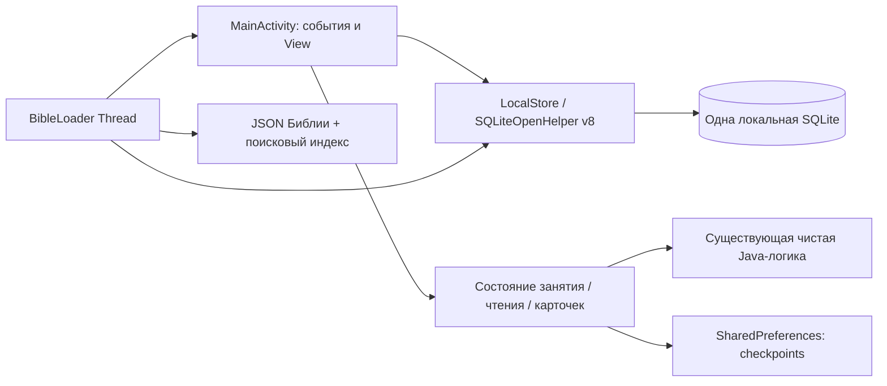

# Архитектурный рефакторинг: этап 1

База аудита: `a2acc0a5bddc5357e610a7cb760bc81a0bb52259`.
Рабочая ветка: `refactor/architecture-safety`. Основная ветка не изменяется.

Выполнены аудит, защитные проверки и план изолированных изменений.
Этапы 2–5 не начаты. Производственный код, ресурсы, зависимости, схема БД,
алгоритмы и пользовательские сценарии в этом этапе не изменены.
Ответственность MainActivity/LocalStore пока не уменьшена: это следующий этап,
а не результат добавления тестов.

## Текущая архитектура и потоки данных

- Java 17; AGP 8.7.3; Gradle 8.9; compileSdk 35, targetSdk 34, minSdk 26.
- Единственная Activity/LAUNCHER — `org.biblememory.app.MainActivity`.
  Интерфейс создаётся Java View-кодом; производственных внешних зависимостей нет.
- `MainActivity.java`: 6482 строки. Совмещены экраны/кэш вкладок, построение View,
  состояния упражнений, карточек, чтения, поиска, очередей и сохранение результата.
- `LocalStore.java`: 1386 строк; единственный SQLiteOpenHelper,
  `slovo_pamyat.db`, **user_version=8**, внешние ключи включаются в onConfigure.
- Формат JSON-копии — `slovo-pamyat-v5`; это отдельная версия формата, не версия SQLite.
- Расчётные классы уже выделены: LessonCurriculumLogic, StudyPlanLogic,
  ReviewLogic, SpacedReviewLogic, TypingDiffLogic, FlashcardDeckLogic,
  AdaptiveLearningLogic, SequenceRecallLogic/Controller, BibleSearchLogic и другие.
  Их следует переиспользовать, а не переписывать.



| Область | Где сохраняется | Фактические границы |
| --- | --- | --- |
| Учебные материалы | groups_, entries, study_order | add/update, restoreOrAddStudyPassage, reorderStudy |
| Прогресс и повторения | verse_progress, stage_progress, lesson_progress, recall_activity, review_schedule, review_attempts, transition_issues | finishExercise, markMastered, recordRecall, scheduleReview |
| Карточки | card_decks, flashcards, card_deck_members, card_order | addFlashcard/addCustomFlashcard, removeFlashcard, reorderCards |
| Объединённые коллекции | unified_collections, unified_card_entries, unified_entry_cards | create/clear/deleteUnifiedCollection, addPickedPassage, syncUnifiedCollection |
| Незавершённые занятия | study_session | entry_<id>_, linked_<id>_, review_; черновик, seed, маска, плитки, флаги подсказок |
| Просмотр карточек | card_sessions | deck_<id>: порядок, cursor, reference_first |
| Проверка коллекции | unified_library_ui | writing_run_<id>_: cursor, draft, checked/passed, missed |
| Выбор отрывка | Bundle + PassageSelection | onSaveInstanceState/restorePickerState; отдельно от обычного чтения |

onCreate открывает helper, восстанавливает метаданные и строит экран.
Отдельный BibleLoader загружает Библию/поиск, синхронизирует коллекции и публикует
render на UI-поток. В обычных обработчиках UI также напрямую вызываются SQLite
и syncUnifiedCollection. checkAnswer/lessonWrite выполняют расчёт, затем несколько
отдельных операций recordRecall → scheduleReview → markMastered/finishExercise → update.
onPause сохраняет checkpoint занятия/карточек/проверки. onDestroy закрывает helper,
отменяет поиск и home ticker, но не владеет завершаемым заданием BibleLoader.

## Проверенные нарушения безопасности данных

Три диагностические проверки требуют желаемой безопасности и **падают ожидаемо**
на существующем коде. Это выполненные воспроизведения дефектов, не пропуски и не
успешные защитные проверки. Они помечаются EXPECTED_FAILURE отдельным типом
assertion; ошибки подготовки/очистки fixture не могут попасть в эту категорию.

1. **P0: удаление заполненной «Мои стихи» при обновлении старой БД.**
   LocalStore.onUpgrade при from<6 безусловно выполняет DELETE по названию.
   На fixture v5→v8 исчезает entry с прогрессом из заполненной группы.
   ON DELETE CASCADE удаляет зависимые записи. Комментарий связывает DELETE
   с прежним удалением стартовой коллекции, но SQL не отличает пустую служебную
   коллекцию от заполненной пользовательской с тем же названием.
2. **P1: прямой syncUnifiedCollection не атомарен.**
   При отклонении INSERT в unified_entry_cards созданная карточка и её membership
   уже зафиксированы. Метод выбрасывает SQLiteConstraintException, но остаётся
   одна карточка без соответствующего entry mapping. Вызов внутри addPickedPassage
   защищён внешней транзакцией и откатывается полностью; прямые вызовы из загрузчика
   и экранов такого внешнего владельца транзакции не имеют.
3. **P1: повтор после такого сбоя создаёт дубликат.**
   После снятия инъекции и повторного sync у двухстрочного пользовательского
   отрывка получается **три карточки вместо двух**. Нормальная синхронизация без
   сбоя отдельно проверена как идемпотентная. Проблема связана с частичной записью,
   а не со всеми вызовами синхронизации.

Инъекция — SQLite trigger с RAISE(ABORT) в тестовой БД. Она проверяет реальные
границы транзакций Android SQLiteOpenHelper. Это не утверждение, что при обычном
нажатии всегда возникает такой сбой. Отдельно проверено: отклонение записи
review_schedule корректно откатывает и review_attempts; дефект там не подтвердился.

## Дополнительные риски и границы аудита

- **По коду, без отдельного fault-теста:** несколько транзакций результата
  упражнения не образуют одну общую транзакцию. Сбой между recordRecall и следующими
  вызовами может оставить частично применённый результат. Будущий ProgressRepository
  должен владеть полной записью результата, сохраняя прежние вычислительные правила.
- **По коду:** BibleLoader не отменяется/не отсоединяет callback при уничтожении
  Activity; tabWarmHandler также не очищается в onDestroy. Есть риск позднего render
  и обращения к helper после закрытия. Утечка памяти и реальный crash не доказаны
  профилировщиком. Гонка финального стартового render была воспроизведена в тестовом
  стенде и устранена ожиданием готовности именно в стенде.
- **По коду:** statusesForChapter, matchingVerseLocations, masteryCount,
  unifiedCollection и sync выполняют повторные чтения/разбор JSON во вложенных циклах;
  часть вызывается на UI-потоке. Количественные FPS/IO-замеры здесь не выполнялись.
  Lint дополнительно сообщает 15 DrawAllocation; это статические сигналы, не замер FPS.
- **По формату:** JSON-копия экспортирует группы/записи и их учебную историю,
  но не полный набор таблиц карточек, порядков и unified mappings. Не считать её
  полной страховочной копией всей БД перед будущими изменениями хранения.
- В доступной Git-истории начальная версия LocalStore уже имеет схему v8.
  Fixtures v1–v7 реконструированы независимо от текущего onCreate по контрактам
  onUpgrade. Настоящих баз из семи старых опубликованных APK в распоряжении нет.
  Совместимость со всеми реальными историческими установками этим не доказана.
- SessionStateSafetyCheck проверяет существующие методы сериализации на новых
  экземплярах Activity с изолированным Context, без запуска её UI/onCreate.
  Это не тест убийства процесса, клавиатуры или полного восстановления учебного
  экрана. Реальное пересоздание picker покрыто существующим Robolectric-сценарием.
- Native проверки выполнены на API 28, не на всей матрице API 26–35 и не на
  пользовательском телефоне с большой старой базой. Локальная БД тестового AVD
  не подменялась: SHA-256 её основного файла до/после storage-прогона совпал.
- CI сейчас собирает APK только для main/master и вручную; optional init-скрипты
  тестов автоматически в этот workflow не включены. Нет новой сетевой зависимости
  в приложении; тестовый Robolectric остаётся только в существующем test harness.

## Изменённые файлы и что защищено

| Файл | Назначение |
| --- | --- |
| tests/PickerIntegrationTest.java | Дождаться BibleLoader перед установкой тестового состояния; прикрепить/измерить View и создать ListView-header перед проверкой. Все прежние утверждения сохранены; добавлена диагностика геометрии. |
| tests/LearningContractsTest.java | 13 правил фаз/порогов, seed, точности, двух расписаний, границ учебных шагов, длинного текста и циклов карточек. |
| tests/device/org/biblememory/app/SafetySandbox.java | Собственный каталог SQLite, UUID-префиксы preferences, сохранение изоляции через applicationContext, очистка только своих fixtures. |
| tests/device/org/biblememory/app/LegacyDatabaseFixture.java | Синтетические схемы 1–7 с фиксированными ID, sparse/prefix mastery, историей, due/ease, карточками и порядками. |
| tests/device/org/biblememory/app/StorageSafetyCheck.java | 18 проверок реальной SQLite и 3 отдельных воспроизведения известных дефектов. |
| tests/storage-safety-device.init.gradle | Подключение storage-runner без изменения приложения/производственных зависимостей. |
| tests/device/org/biblememory/app/SessionStateSafetyCheck.java | 8 проверок checkpoints: черновик/маска/seed/feedback/плитки, namespaces, corrupt metadata, run cursor, карточки, VERSE_RUN, Bundle picker. |
| tests/session-safety-device.init.gradle | Подключение session-runner. |
| docs/ARCHITECTURE_REFACTOR_STAGE_1.md | Аудит, результаты, ограничения и порядок дальнейших изменений. |

Миграции 1→8 … 7→8 проверяют прежние значения записей и ID, разреженное освоение,
расписания/попытки, карточки/порядок при наличии в старой схеме, foreign_key_check
и отсутствие повторной миграции при reopen. Отдельная ошибка внутри onUpgrade
проверяет откат DDL, данных и user_version, затем успешный retry.
Проверены очистка/архивация без потери истории, возврат того же entry ID,
общие канонические карточки и mastery без переноса на пользовательский текст,
идемпотентность исправного sync, assisted recall, независимое расписание,
восстановление учебной истории из JSON и отсутствие частичного некорректного импорта.

## Реальные результаты

| Проверка | Результат |
| --- | --- |
| Исходный полный JUnit/Robolectric запуск | 55 выполнено: 51 прошло, 4 падения стенда; без изменения приложения. |
| Полный запуск после исправления стенда и добавления контрактов | **68 выполнено, 0 failures/errors, 0 skipped**; в том числе все 36 Android/Robolectric-сценариев. |
| APK + instrumentation APK | Gradle-сборки успешны. |
| Реальная SQLite, API 28 | **18 guards прошли**, 3 EXPECTED_FAILURE, 0 неожиданных ошибок. |
| Checkpoints, API 28 | **8 guards прошли**, 0 неожиданных ошибок. |
| Данные встроенной Библии | 66 книг; Псалтирь 150 глав, Псалом 118 — 176 стихов; проверка диапазонов Матфея проходит. |
| Подпись APK | Проверена apksigner. |
| Lint | **Не проходит**: существующий NewApi, styles.xml:5, windowLightNavigationBar требует API 27 при minSdk 26; также 41 предупреждение. Ресурс не изменён. |
| git diff --check | Проходит; в app/ и производственной конфигурации изменений нет. |

Нельзя объединять три EXPECTED_FAILURE с успешными guards или утверждать,
что существующее хранение полностью безопасно. Ранее недоступный Robolectric
теперь запускается: после публикации сетевого разрешения mirror доступен.
Assertions не отключались, тесты не помечались Ignore, production-логика не менялась
для получения зелёного результата.

## Команды воспроизведения

Из корня проекта с JDK 17, SDK 35 и Gradle 8.9:

```sh
gradle --no-daemon --max-workers=4 -I tests/validation.init.gradle -x :app:createSynodalSearchIndex :app:testDebugUnitTest
gradle --no-daemon --max-workers=4 -I tests/storage-safety-device.init.gradle -x :app:createSynodalSearchIndex :app:assembleDebug :app:assembleDebugAndroidTest
adb install -r app/build/outputs/apk/debug/app-debug.apk
adb install -r app/build/outputs/apk/androidTest/debug/app-debug-androidTest.apk
adb shell am instrument -w org.biblememory.app.test/org.biblememory.app.StorageSafetyCheck
gradle --no-daemon --max-workers=4 -I tests/session-safety-device.init.gradle -x :app:createSynodalSearchIndex :app:assembleDebug :app:assembleDebugAndroidTest
adb install -r app/build/outputs/apk/androidTest/debug/app-debug-androidTest.apk
adb shell am instrument -w org.biblememory.app.test/org.biblememory.app.SessionStateSafetyCheck
python3 tests/check_bible_grids.py
"$ANDROID_HOME/build-tools/35.0.0/apksigner" verify app/build/outputs/apk/debug/app-debug.apk
gradle --no-daemon --max-workers=4 -x :app:createSynodalSearchIndex :app:lintDebug
git diff --check
```

Проверять instrumentation summary, а не только код возврата shell:
`GUARDS_PASSED=18 EXPECTED_FAILURES=3 UNEXPECTED_FAILURES=0` и
`SESSION_GUARDS_PASSED=8 UNEXPECTED_FAILURES=0`.
APK instrumentation нужно пересобрать/переустановить при смене runner.
Использовать отдельный AVD; не очищать данные установленного приложения.
В этой облачной среде host adb пишет в read-only HOME; использован подготовленный
Python adb-shell `/workspace/toolchains/device.py` с последовательными push/shell,
одним соединением за раз. Настройки HOME/защиты/системных анимаций не менялись.
Исключение createSynodalSearchIndex сохраняет отслеживаемый bundled индекс.

## Следующий безопасный шаг и последовательность

**Сначала — отдельная минимальная правка P0-миграции.** Сохранить заполненную
«Мои стихи» с исходными ID/историей; удалять только действительно пустую служебную
группу. Не увеличивать версию схемы без необходимости. Превратить соответствующее
воспроизведение в обязательный успешный guard. Уже удалённые ранее данные такая
правка не восстанавливает: для восстановления нужна прежняя копия.

Следующим отдельным коммитом сделать прямой sync атомарным на том же helper:
одна внешняя транзакция, отсутствие частичных memberships/mappings при ошибке,
безопасный retry. Не глотать SQLite-ошибки как ошибки недоступного старого текста;
разделить эти случаи и регистрировать факт сбоя без содержимого пользовательских
текстов. Сохранить текущий skip при неготовой Библии и защиту addPickedPassage.
Проверки отката, обычной идемпотентности и retry должны проходить; два оставшихся
воспроизведения перевести в обязательные guards. Это исправления подтверждённых
дефектов отдельными коммитами, а не перенос большого объёма кода.

После этого переносить по одному компоненту:

| Шаг | Конкретная граница | Обязательная защита |
| --- | --- | --- |
| 2а | Выделить checkpoint/state codec из save/restoreTrainingSession, saveCardSession, save/restoreRunSession. Не менять ключи, значения enum, VERSE_RUN, fallback и момент сохранения. | 8 session guards + реальные сценарии lifecycle; при появлении нового seam убрать ненужную reflection без ослабления контрактов. |
| 2б | StudySessionController: состояние занятия и переходы; существующие Logic-классы вычисляют результат. Java Views/анимации остаются прежними, Activity делегирует через узкие callbacks. | LearningContracts, assisted/feedback, интервалы, незавершённые занятия и очереди; отдельный коммит для каждого потока. |
| 2в | BibleReaderController: состояние чтения и отдельный PassageSelection для коллекций; поиск со своим отменяемым заданием. | Все 22 picker/reader/search сценария, 176 стихов, reselect/back, кэш вкладок и прежние анимации. |
| 2г | FlashcardSessionController: порядок/cursor/reference-first и shuffle через FlashcardDeckLogic. | Сохранённый цикл, отсутствие повторов на границе, независимость deck checkpoints, сценарий настоящего открытия сессии. |
| 2д | CollectionController: создание/переименование/архивация/выбор активной коллекции; не переносить сразу весь View-код. | Архив/re-add с тем же ID, shared membership, порядок материалов, пустая/удалённая коллекция. |
| 3 | StudyRepository, ProgressRepository, FlashcardRepository, CollectionRepository: переносить реальные SQL-методы группами, а не оставлять весь SQL под новыми фасадами. SQLiteOpenHelper/migrations/transaction owner остаётся один; межрепозиторная операция использует тот же database/transaction. | Матрица миграций, injected rollback, все ID/foreign keys/history, обычный и аварийный sync; перед изменениями получить репрезентативные исторические базы. |
| 4 | ExerciseOutcome отделяет вычисление от изменения состояния; ProgressRepository записывает полный результат упражнения одной транзакцией. Сохранить current правила exact/assisted/mastery и оба существующих расписания. | Fault injection между частями записи результата; неизменность due/ease, дней, освоенных позиций и обратная совместимость checkpoints. |
| 5 | Измерить UI-thread SQLite/JSON и длинные отрывки, затем устранить только подтверждённые узкие места. Явный owner заданий/отмена callback до закрытия store; coalescing/очереди — после фиксации гарантий сохранения. | Длинный Псалом/много коллекций, StrictMode/IO и профилировщик, rapid navigation, destroy/recreate/process restart, отсутствие поздних UI callbacks. |

После каждого небольшого переноса — сборка, относящиеся guards, проверка данных
и поведения, затем коммит. Не менять main напрямую, не выполнять force push,
не смешивать перенос UI, изменение схемы и алгоритмов. Отдельно можно исправить
ресурсную API-конфигурацию Lint в compatibility-коммите; не подавлять NewApi
и не менять тему ради прохождения архитектурных тестов.
