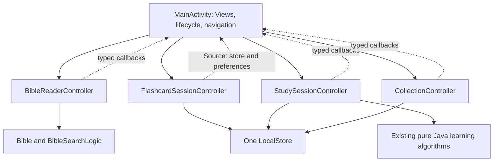

# «Светоч»: этап 2 — контроллеры MainActivity

База: `be7d97d` (результат этапа 1). Рабочая ветка: `refactor/main-controllers`.

## Подготовка и безопасная последовательность

Изучены все 189 полей и 280 методов верхнего уровня исходного MainActivity
(6 482 строки). [Карта зависимостей](architecture/main-activity-dependencies.md)
составлена перед извлечением с привязкой Java-символов, включая ссылки из lambda,
вложенных классов и method references. Текстовые совпадения в строках/комментариях
не использовались для замены идентификаторов.

Защитные тесты этапа 1 присутствовали. Базовая APK-сборка и 68 JUnit/Robolectric
тестов прошли. Три воспроизведения известных дефектов хранения всё ещё считались
EXPECTED_FAILURE. До переноса компонентов они исправлены отдельно:

- `90faa07`: миграция удаляет только **пустую** стартовую «Мои стихи»;
  заполненная группа, её ID и связанная история сохраняются.
- `9aec9e3`: прямой sync unified-коллекции выполняется в одной транзакции
  того же SQLiteOpenHelper. SQLiteException в legacy-цикле больше не проглатывается;
  откат и повторный запуск проверены fault injection. Лог содержит ID и тип ошибки,
  без пользовательского текста/SQL-параметров.

Изначальные три воспроизведения стали обязательными успешными guards;
добавлены проверки пустой стартовой группы и ошибки внутри legacy-цикла.
Итог хранения: **23 guards, EXPECTED_FAILURES=0, UNEXPECTED_FAILURES=0**.
Схема остаётся версии 8. Исторический отчёт этапа 1 не переписан задним числом.

Затем последовательно извлечены Flashcard → Study → BibleReader → Collection.
После каждого компонента выполнены сборка, полный набор доступных unit-тестов,
нативные проверки checkpoints, просмотр diff и отдельный коммит. Последним
отдельным изменением завершён перенос действий урока и переходов повторения.

## Созданные и изменённые классы

| Класс | Ответственность |
| --- | --- |
| **BibleReaderController** (новый) | Состояние чтения и выбора отрывка, переходы сеток, выбранный стих/границы, поиск с debounce и проверкой поколения, отмена задач, загрузка Библии, snapshot. |
| **FlashcardSessionController** (новый) | Последовательность/курсор/направление/открытая сторона карточек, checkpoint, подготовка и продолжение независимой card-study очереди, snapshot. |
| **StudySessionController** (новый) | Состояние урока/ответов/плиток/масок, восстановление checkpoints, начало/продолжение уроков и связок, очередь повторений, проверка письменного ответа, правила assisted/exact и переход после успеха, writing-run, snapshot. Существующие алгоритмы вызываются без изменений. |
| **CollectionController** (новый) | Unified CRUD/очистка, активная коллекция, добавление/удаление выбранных материалов, проверка membership, порядок вставки и перестановка, сохранение/продолжение очереди независимых записей, sync. |
| **SessionSnapshot** (новый) | Типизированное кодирование списков ID, Step и DueItem в Bundle. Не хранит Activity/View/SQLite-соединения. |
| **Screen** (новый) | Прежний enum экрана вынесен в общий package-private тип. Активный экран остаётся у Activity. |
| **PassageText** (новый) | Прежнее соединение текста стихов одним пробелом; используется несколькими компонентами без связи controller → controller. |
| **MainActivity** (изменён) | Java View-композиция, диалоги, lifecycle/Back, активный экран, кэш и переходы вкладок, анимации; адаптеры портов контроллеров и применение сохранённой прокрутки. |
| **LocalStore** (изменён) | Только два предварительных исправления подтверждённых дефектов хранения, описанных выше. |

Дополнены тестовые классы ControllerIntegrationTest, ActivityRecreationIntegrationTest,
ActivityRecreationCheck, StorageSafetyCheck и SessionStateSafetyCheck. В существующих
PickerIntegrationTest, BookNavigationIconTest, HomeNavigationIconTest и нативных
иконных проверках изменён доступ к перемещённым полям/enum через test-only
ActivityTestAccess. Проверки поведения сохранены; production-reflection не добавлена.
Init-скрипты подключают test-support, а новый recreation-скрипт запускает нативный runner.

## Какие зависимости стали проще



Каждое извлечённое состояние имеет одного владельца. Контроллеры не импортируют
MainActivity/View и не требуют конкретных классов соседних контроллеров.
Activity соединяет их через узкие callback-порты. Это сохраняет прежний порядок
UI-действий и операций хранения, позволяет проверять сессии без построения View
и не создаёт дополнительных SQLiteOpenHelper или независимых транзакционных владельцев.

В MainActivity больше нет собственных очередей карточек/уроков/коллекций,
поисковых executor/debounce/generation, reader/picker-модели, проверки полного
письменного ответа и построения очереди повторения. Код отрисовки ошибок отделён
от проверки ответа; смена текста/проверки продолжает использовать прежние правила.

## Восстановление Activity

Помимо существующих SharedPreferences-checkpoints, каждый контроллер сохраняет
свой namespaced Bundle. MainActivity сохраняет экран и позиции прокрутки,
восстанавливает контроллеры **до** render и запуска загрузки Библии.

Сохраняются ответ, seed/маска/выбранные плитки, feedback-флаги, контекст связки и
повторения, очередь/курсор, порядок и раскрытая сторона карточек, reading/picker
и поиск. Writing-run восстанавливает материалы из текущей базы, а не помещает
полные тексты коллекции в Bundle. Прокрутка применяется после готовности данных
и layout; ранний loading-render не перезаписывает её нулём.

Старые picker Bundle-ключи и пространства preference-checkpoints сохранены.
На onSaveInstanceState также записывается свежий checkpoint активного режима.
Восстановление не вызывает повторную проверку ответа, начисление прогресса или
перепланирование повторения. После ошибки восстанавливается видимый разбор
полного ответа, и исправление по-прежнему требует свежей самостоятельной попытки.

Reader владеет загрузчиком и поисковыми заданиями: close отменяет отложенную
работу, закрывает executor, прерывает loader; callbacks проверяют закрытие/поколение.
Activity удаляет также callbacks прогрева вкладок при уничтожении.

## Размер MainActivity

Счёт методов/полей выполнен Java Compiler Tree API по **прямым членам класса**;
методы вложенных View не включены ни до, ни после. Строки включают комментарии
и пустые строки; оставшиеся после перемещения пустые блоки удалены.

| Метрика | Этап 1 | После этапа 2 | Изменение |
| --- | ---: | ---: | ---: |
| Строки | 6 482 | **5 347** | −1 135 |
| Методы верхнего уровня | 280 | **200** | −80 |
| Поля верхнего уровня | 189 | **77** | −112 |

Activity остаётся большой: основной объём — существующая программная Java
View-разметка, графика и обработчики экранов. Она не скрыта в бессодержательных
фасадах и не переписана на другую UI-систему. Некоторые старые экранные обработчики
и read-запросы ещё обращаются к LocalStore напрямую; полная граница хранения —
следующий этап, а не незаявленная переделка в этом изменении.

## Проверки

Среда: JDK 17, Gradle 8.9, SDK/build-tools 35; Robolectric 4.14.1, API 28 AVD
с программным рендерингом. Production-зависимости и конфигурация UI не изменены.

| Граница | Полный JUnit/Robolectric | Native checkpoints |
| --- | ---: | ---: |
| Базовая версия | 68 passed | 8 passed |
| Flashcard | 74 passed | 8 passed |
| Study | 78 passed | 8 passed |
| BibleReader | 81 passed | 8 passed |
| Collection | 85 passed | 8 passed |
| Activity recreation | 94 passed | 3 настоящих recreate-сценария passed |
| Действия урока и итог | **98 passed, 0 failures/errors/skipped** | **8 passed** |

Итоговая обычная сборка `assembleDebug`, `assembleDebugAndroidTest` и
`testDebugUnitTest` успешна **без исключения createSynodalSearchIndex**.
98 тестов включают 20 прямых контрактов контроллеров и 10 настоящих JVM-сценариев
Activity recreation. Отдельно проверена передача Bundle через Android Parcel
в новый экземпляр Activity.

Нативный ActivityRecreationCheck проверяет незавершённый ответ без записи прогресса,
порядок/направление/раскрытие карточек и чтение Псалма 118 с восстановлением
прокрутки и переходом Back к сетке из 176 стихов.

Итоговые результаты нативных и статических проверок записаны в
[протоколе](validation/architecture-stage2.txt).

## Команды воспроизведения

```sh
gradle --no-daemon --max-workers=4 -I tests/validation.init.gradle :app:assembleDebug :app:testDebugUnitTest
```

Для каждого нативного runner пересобрать и переустановить test APK; все команды
выполнять последовательно на отдельном AVD, не очищая данные установленного приложения:

| Init-скрипт в `tests/` | Instrumentation runner в пакете `org.biblememory.app` |
| --- | --- |
| storage-safety-device.init.gradle | StorageSafetyCheck |
| session-safety-device.init.gradle | SessionStateSafetyCheck |
| recreation-device.init.gradle | ActivityRecreationCheck |
| bible-icon-device.init.gradle | BibleIconCheck |
| collections-icon-device.init.gradle | CollectionsIconCheck |
| home-icon-device.init.gradle | HomeIconCheck |

```sh
gradle --no-daemon --max-workers=4 -I tests/recreation-device.init.gradle :app:assembleDebug :app:assembleDebugAndroidTest
adb install -r app/build/outputs/apk/debug/app-debug.apk
adb install -r app/build/outputs/apk/androidTest/debug/app-debug-androidTest.apk
adb shell am instrument -w org.biblememory.app.test/org.biblememory.app.ActivityRecreationCheck
python3 tests/check_bible_grids.py
"$ANDROID_HOME/build-tools/35.0.0/apksigner" verify app/build/outputs/apk/debug/app-debug.apk
gradle --no-daemon --max-workers=4 :app:lintDebug
git diff --check
```

Проверять summary/`PASS`, а не только exit code shell `am instrument`.
В облачной среде использован уже подготовленный Python adb-shell клиент,
поскольку системный adb пытается писать в read-only HOME. Защита/HOME не менялись.

## Ограничения и следующий этап

- Lint остаётся красным: **1 существующая ошибка NewApi** в
  `app/src/main/res/values/styles.xml:5` (`windowLightNavigationBar`, API 27 против
  minSdk 26) и **41 предупреждение**. Тема не изменялась, проверки не подавлялись.
- Разметка/рисование остаются в Activity. Некоторые старые обработчики и
  экранные запросы сохраняют прямую связь с LocalStore; это не полная изоляция
  UI от хранения. Новые контроллеры не являются repository-слоем.
- Использованы синтетические исторические базы версий 1–7 и fault injection.
  Реальных исторических пользовательских баз и физического телефона нет;
  программный AVD не заменяет профилирование FPS/IO на телефоне.
- Снимок восстанавливает управляемое Android пересоздание/возврат сохранённого
  Bundle. Force-stop без сохранённого Bundle использует прежние durable checkpoints
  и обычный старт с Главной; автоматическое открытие прошлого экрана при каждом
  холодном запуске не добавлялось.

Рекомендуемый **этап 3**: разделить операции LocalStore по предметным repository
контрактам, сохранив **один SQLiteOpenHelper и общий transaction owner**. Начать
с материалов/коллекций и заменить оставшиеся экранные обращения к storage
методами команд/запросов; переносить по одной операции с теми же guards. До
переделки миграций получить реальные исторические базы. Отдельно согласованным
compatibility-изменением можно исправить существующую ресурсную ошибку API 26.
Не смешивать это с изменением учебных алгоритмов или новой UI-архитектурой.

## Логические коммиты

| Коммит | Изменение |
| --- | --- |
| 90faa07 | Сохранение заполненной стартовой группы при миграции |
| 9aec9e3 | Атомарный sync и безопасный retry |
| ce04d88 | FlashcardSessionController и его контракты |
| d3e4a47 | StudySessionController: состояние, вычисления, checkpoints |
| 14bda08 | BibleReaderController, поиск/загрузка/выбор |
| 92c48cc | CollectionController, membership/порядок/очередь |
| 2a032b3 | Снимки состояния и реальное Activity recreation |
| 53d55bd | Действия урока/повторения и отделение от View-feedback |

Изменения ресурсов, размеров, цветов, шрифтов, иконных классов/анимаций,
основного кэширования вкладок, pure-Java правил exact/интервального повторения,
схемы/версии SQLite и production-зависимостей отсутствуют в diff.
