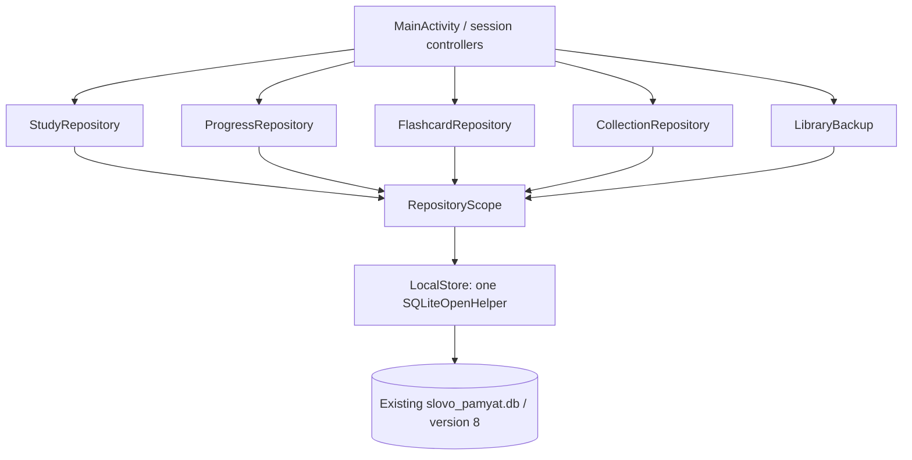

# «Светоч»: этап 3 — репозитории SQLite

База: `c160206`, завершённый этап 2. Ветка: `refactor/localstore-repositories`.

## Подготовка

Рабочая копия этапа 2 была чистой, локальный и опубликованный хеши совпадали.
Обычная сборка APK/test APK прошла; затем принудительно выполнены все **98**
JUnit/Robolectric-тестов (`--rerun-tasks`), а на API 28 AVD — все **23** storage
проверки без EXPECTED_FAILURE и неожиданных ошибок. Блокирующих проблем этапа 2 нет.

До переноса разобраны все методы LocalStore, таблицы, внешние ключи, индексы,
миграции и операции над несколькими таблицами. [Исходная карта зависимостей](architecture/localstore-dependencies.md)
содержит 91 метод верхнего уровня, включая конструктор, и назначения владельцев.
Перенос выполнялся последовательно: инфраструктура → материалы → прогресс →
карточки → коллекции → старый backup codec → общие транзакции → вызывающий код.
После каждого извлечения выполнялись сборка и полный набор доступных unit-тестов.

## Новые классы

| Класс | Назначение |
| --- | --- |
| `RepositoryScope` | Один SQLiteOpenHelper/SQLiteDatabase owner для всех репозиториев; общая транзакционная функция с rollback, включая вложенные вызовы. |
| `StudyRepository` | Учебные записи/тексты, чтение и изменение материалов, каноническая идентичность, скрытая библиотека, порядок изучения. Координирует редактирование материала с переносом истории и инвалидированием связей. |
| `ProgressRepository` | Упражнения, освоение, recall, попытки, расписание, закрепление, слабые переходы и состояния главы. Владеет переносом истории при редактировании материала. |
| `FlashcardRepository` | Карточки, старые колоды, membership, порядок карточек, замена/удаление; точечный поиск карточки по существующим ключам. |
| `CollectionRepository` | Группы и unified-коллекции, создание/переименование/удаление/очистка, связи, добавление отрывка с карточками, архивирование и sync. Владеет инвалидированием связей изменённого материала. |
| `LibraryBackup` | Существующий append-only codec форматов v1–v5. Вынесен отдельно, чтобы инфраструктура SQLite не содержала сериализацию и массовый импорт. Формат не расширялся. |

Репозитории содержат реальные SQL-операции, перенесённые из LocalStore.
Они не являются фасадами над прежними реализациями. Репозитории не создают
SQLiteOpenHelper, физические базы или независимые соединения.

## Зависимости

MainActivity создаёт и закрывает один LocalStore для своего lifecycle. LocalStore
создаёт один scope и по одному экземпляру репозиториев. Scope передаёт всем тот же
helper; межрепозиторные вызовы работают в транзакции одного SQLiteDatabase.
Контроллеры получают через свои порты только необходимые типизированные
репозитории. Их прежний доступ ко всему LocalStore удалён. MainActivity использует
типизированные accessors и сохраняет ответственность за lifecycle.

Изменены 188 привязанных к методам LocalStore мест вызова в Activity и трёх
контроллерах. Привязка определялась Java Compiler API, включая method references;
строки и комментарии не заменялись по совпадению текста. Все строковые литералы
этих четырёх UI/controller-классов идентичны версии этапа 2.

Связанные операции не разделены на независимые commits SQLite:
`addPickedPassage` вызывает Study/Flashcard/sync/order в общей транзакции;
`reviseStudyPassage` вызывает Progress.remapForRevision и
Collection.invalidateEntryCards, передавая тот же database внутри своей транзакции.
Общие lookup-зависимости между материалами и прогрессом сохранены без изменения
правил канонического сопоставления.

## Что осталось в LocalStore

| Метрика | До | После |
| --- | ---: | ---: |
| Строки | 1 401 | **276** |
| Методы верхнего уровня, включая конструкторы | 91 | 84 |

Из оставшихся методов **65 — короткие совместимые делегаты** прежнего публичного
API. Они не дублируют SQL; приложение использует репозитории напрямую. Это
сохраняет существующие вызовы/тесты и не заставляет одновременно переписывать
модельные типы. Семь вложенных DTO `LocalStore.*` сохранены побайтно.

LocalStore владеет открытием/закрытием, FK configuration, схемой, миграциями и scope.
Добавлен package-private конструктор с обычным SQLite CursorFactory для нативного
измерения запросов; production-конструктор передаёт прежнее значение `null`.

## Схема и данные

Имя файла **`slovo_pamyat.db`**, версия **8**, все 17 прикладных таблиц,
внешние ключи, PK/UNIQUE-индексы и существующие миграции сохранены.
Новых CREATE/ALTER/DROP таблиц или индексов нет. Все 11 методов создания схемы,
миграции и настройки SQLite побайтно совпадают с этапом 2.

| Основная область | Таблицы |
| --- | --- |
| Материалы | entries, study_order |
| Прогресс | verse_progress, stage_progress, lesson_progress, recall_activity, review_schedule, review_attempts, transition_issues |
| Карточки | card_decks, flashcards, card_deck_members, card_order |
| Коллекции | groups_, unified_collections, unified_card_entries, unified_entry_cards |

Согласованные операции и старый backup codec обращаются к связанным таблицам
через общий scope; это не отдельные базы для перечисленных областей.

## Исправленные проблемы целостности

Нативная fault injection до исправлений воспроизвела шесть окон частичного commit:

1. `removeUnifiedPassage`: запись уже перемещена в архив, но удаление membership падает.
2. `removeFlashcard`: membership удалён до ошибки удаления последней карточки.
3. `changeCardInDeck`: новая карточка сохранена до ошибки удаления старой.
4. `recordWeakTransition`: пустая диагностическая строка остаётся после ошибки UPDATE.
5. `deleteCardDeck`: удаление колоды/membership сохраняется до ошибки очистки orphan-карточек.
6. `findOrCreateCardStudyEntry`: скрытая группа сохраняется до ошибки создания учебной записи.

Теперь каждая операция обёрнута общей транзакцией. При отказе сравниваются все
строки таблиц, включая sequence/ID; частичные изменения не сохраняются.
Сохраняются прежние правила удаления связей и архивирования, общие карточки
других коллекций и FK-связанная история учебной записи.

Атомарность `syncUnifiedCollection`, введённая на этапе 2, сохранена и проверена
rollback/retry/idempotence. SQL-ошибки пробрасываются после записи ID и типа ошибки
без содержимого текста/SQL-параметров. Контролируемый пропуск недоступной legacy
карточки теперь также регистрирует ID/тип ошибки, сохраняя прежний skip.

`scheduleReview` по-прежнему атомарно записывает review_attempts и обновляет
review_schedule. Даты/уровни и правила assisted/failure не изменены. Полный outcome
упражнения, включающий отдельный recordRecall и mastery, не объединялся в новый
алгоритм на этом этапе.

## Подтверждённая оптимизация

Нативный CursorFactory показал **13 полных чтений списка карточек для 12 стихов**:
одно начальное и по одному внутри цикла синхронизации. Теперь полное чтение **одно**,
а поиск каждой канонической карточки выполняется ограниченным SELECT id с проверкой
membership и всех пяти координат отрывка.

EXPLAIN QUERY PLAN на API 28 подтверждает SEARCH через существующие covering
индексы `sqlite_autoindex_flashcards_1` и `sqlite_autoindex_card_deck_members_1`.
Сохранены ID, принадлежность, порядок и результат повторного sync.
Это уменьшение полных чтений, **не** заявление об уменьшении общего числа SQL
операторов до одного или об измеренном FPS. Долгоживущий кэш не добавлен.

## Проверки и обновление установки

| Проверка | Результат |
| --- | --- |
| База этапа 2, принудительный полный запуск | 98 passed |
| После инфраструктуры | 101 passed |
| После StudyRepository | 103 passed |
| После Progress/Flashcard/Collection/backup и обновления callers | 104 passed |
| После разделения revision | 104 passed |
| После аудита оставшихся команд создания/удаления | **106 executed; 0 failures/errors/skipped** |
| APK и instrumentation APK | Обычная Gradle-сборка успешна, без исключённых задач |
| Предыдущие storage guards, API 28 | **23 passed; 0 EXPECTED_FAILURE; 0 unexpected** |
| Новые репозиторные guards, API 28 | **11 passed; 0 unexpected** |
| Checkpoints, API 28 | **8 passed** |
| Настоящее Activity recreation, API 28 | **3 passed**; также 10 JVM lifecycle-сценариев в полном наборе |
| Главная / Библия / Коллекции | Все три нативных runner — PASS, включая навигацию, lifecycle и анимации |
| Данные Библии / подпись APK / diff --check | PASS |
| Lint | Прежний NewApi в styles.xml:5: API 27 против minSdk 26; 1 error, 41 warnings |

Проверено **реальное обновление установленного APK через `pm install -r`**:
старая реализация (без repository API, проверяется reflection) заполняет отдельную
постоянную SQLite-фикстуру. После установки новой APK проверяется существование
того же файла, путь/версия, sqlite_master и все строки/ID/порядок, в том числе
частичные упражнения, mastery, recall, attempts, schedules, weak transitions,
пользовательские тексты, карточки и архив. Затем проверяется отсутствие записей
при чтении через новую реализацию. Результат — INSTALLED_UPGRADE_PASS.
Фикстура изолирована от пользовательской базы установленного приложения.

Точные summaries и команды: [протокол проверок](validation/architecture-stage3.txt).
Полный список изменённых файлов приведён там же.

## Риски и следующий этап

- Миграционная матрица версий 1–7 использует синтетические исторические базы.
  Проверка APK upgrade использует реальные старую/новую реализации, но также
  синтетический набор данных. Реальных исторических пользовательских файлов нет.
- AVD работает с программным рендерингом; физический телефон и FPS/IO профилирование
  не проверялись. Некоторые старые progress lookups обходят материалы/позиции,
  а отдельные UI-обработчики всё ещё синхронно выполняют SQL. Их нельзя считать
  оптимизированными этой адресной заменой поиска карточек.
- LocalStore сохраняет совместимый API и DTO; полное удаление старого API не входило
  в этот безопасный перенос. Общие read-зависимости репозиториев сохраняются.
- Старый JSON backup v1–v5 не является полным дампом карточек/unified metadata/
  порядка. Его формат не расширялся; сохранность этих данных проверена в самой
  SQLite при refactor/upgrade, а не заявлена для прежнего JSON-формата.
- Сохраняется прежняя ресурсная ошибка Lint. Тема не менялась, проверки не подавлялись.

Рекомендуемый **этап 4**: выделить явный ExerciseOutcome и одну команду записи
полного результата упражнения в ProgressRepository/общей транзакции, с fault
injection между recall, schedule, mastery и lesson milestone. Сохранить exact,
assisted и оба прежних расписания. Затем отдельно профилировать тяжёлые UI-thread
чтения на длинных отрывках/большой библиотеке и планировать перенос I/O с контролем
lifecycle; не вводить глобальное кэширование без правил актуализации.
